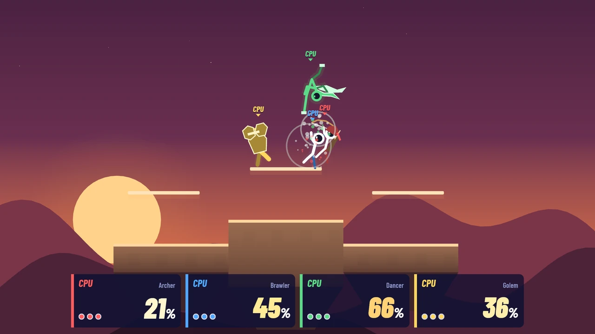
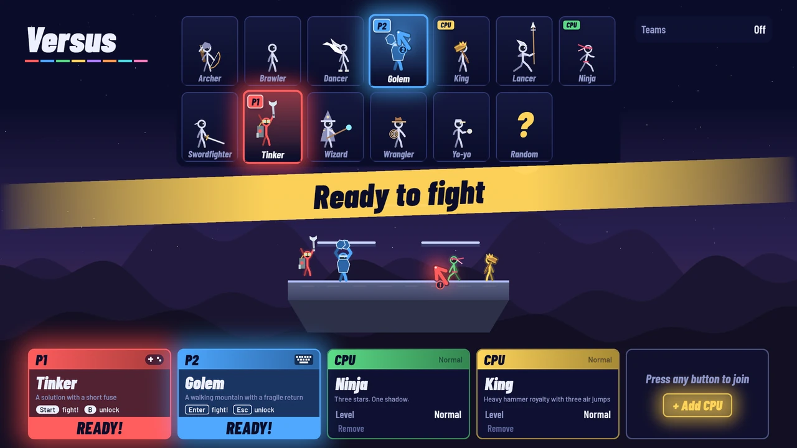
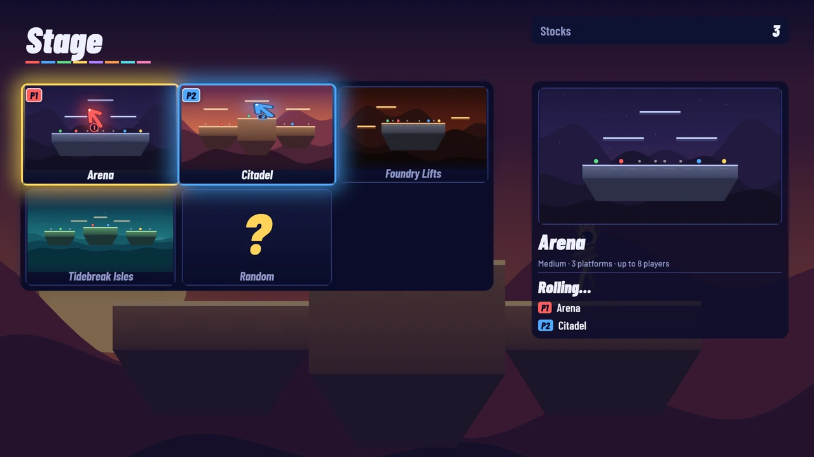
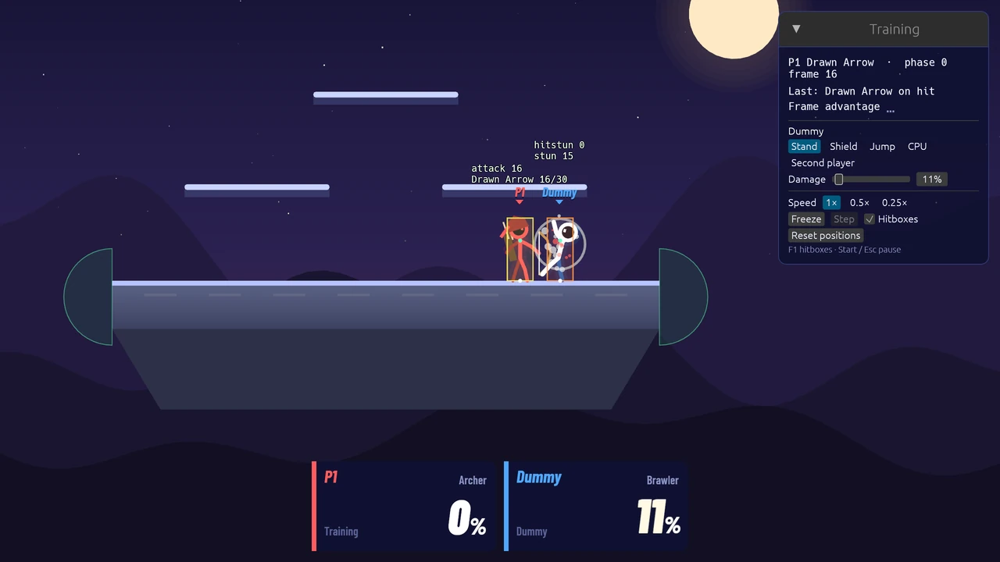
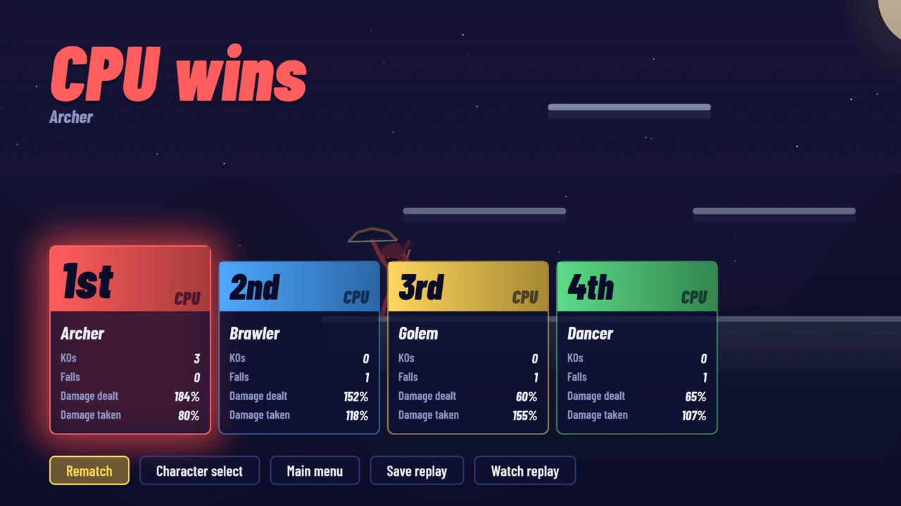
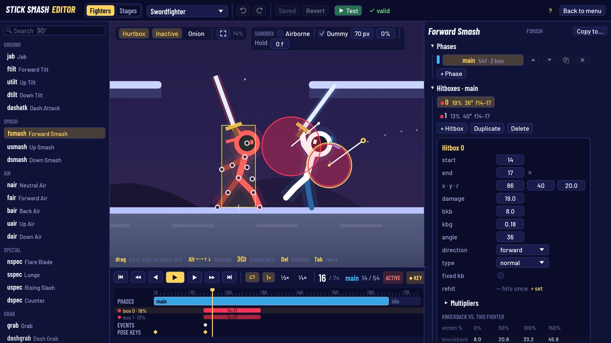
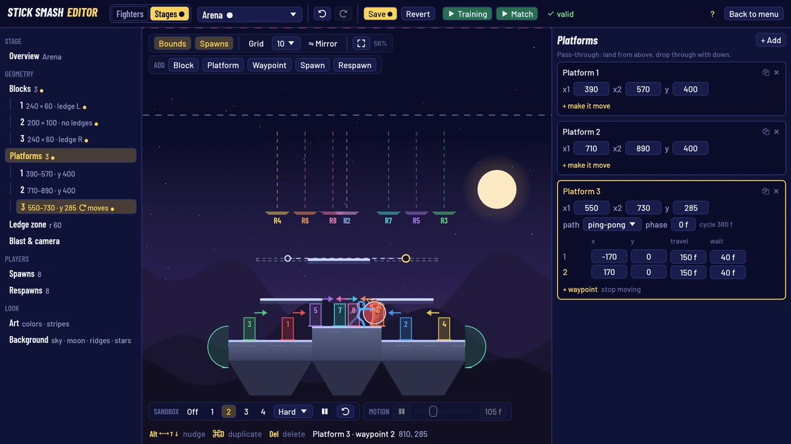

# Stick Smash



A Smash-style platform fighter about stick figures knocking each other off the stage, written in Rust with Bevy.
Up to 8 players share one screen with keyboards and gamepads; add CPUs to fill empty seats. Online play is
planned for later, once local play feels great.

## Quick start

You need a Rust toolchain and [`just`](https://github.com/casey/just). Run from the repository root.

```bash
just release   # play (optimized build; use this to judge feel)
just run       # play (debug build)
just dev       # debug build with dynamic linking, for fast rebuilds while developing
just check     # formatting, clippy and all tests
just shots     # scripted screenshot tour into /tmp/stick-smash-shots
```

`just` on its own lists every recipe.

## Tour

| | |
|---|---|
|  **Character select**: every player steers a pointer and drops their chip on a fighter. |  **Stage select**: everyone votes, then a roulette picks among the votes. |
|  **Training**: frame advantage, combos and a configurable dummy. |  **Results** with per-player stats, and every versus match saved as a replay. |
|  **Fighter editor**: drag hitboxes over the real simulation and scrub the timeline. |  **Stage editor**: blocks, platforms, moving lifts and spawns, with CPUs playing as you edit. |

## How to play

Pick **Versus** or **Training** on the title screen.

**Character select.** Press attack or jump (any button but special / back) on an unused keyboard or gamepad to
join. You get a pointer carrying your chip (P1, P2, …). Move it over a fighter and press attack to drop your chip
there; the "?" tile picks at random. Special (or attack on your chip) picks it back up; with the chip in hand, special
sends the pointer back to the roster, and on the roster leaves. With your hands free you can:

- point at **Add CPU** to add a computer player, then use its card to change its fighter (carry its chip to a
  tile), level (Easy, Normal, Hard) or team, or remove it,
- set the rules: **Teams** and **Friendly fire**,
- press grab or shield to open your options: your team (with Teams on), and whether pressing up jumps.

When everyone has dropped their chip, press start (or attack on your own chip).

**Stage select.** Everyone votes with their pointer by dropping a vote on a stage; Stocks are set here too.
Special takes your vote back (or, with no vote, returns to character select). Once everyone has voted, or someone
presses start once there is a vote (or attack on their own vote), a roulette spins over the voted stages, weighted
by votes, and the match begins. Stages without enough start positions for everyone are dimmed.

**In a match**, knock opponents past the edge of the screen. The more damage they have, the farther they fly.
Start / Esc pauses; only the device that paused controls the pause menu. F1 toggles the hitbox overlay.

**After a match**: rematch, back to character select, main menu, save the replay or watch it. Every completed versus
match is auto-saved (the last 10 are kept, `global.replay.autoSaveCount`; editor test matches aren't recorded);
saved replays stay until you delete them from **Replays** on the title screen.

**Training** is you against a dummy that stands, shields, jumps, fights as a CPU or is played by a second
device. The panel in the top right shows frame advantage and combos, and has the dummy's damage, game speed and
freeze / frame step. See [PLAYTESTING.md](docs/PLAYTESTING.md#training).

### Controls

| | Keyboard | Gamepad |
|---|---|---|
| Move | WASD or arrow keys | Left stick or d-pad |
| Jump | Space, Right Shift (or up) | X or Y (or up) |
| Attack | J or . | A |
| Special | K or / | B |
| Grab | I or ; | RB |
| Shield | L or ' | LB, LT, RT |
| Pause | Esc | Start |

- **Smash attacks**: tap a direction together with attack; hold attack to charge.
- **Dodges**: shield + left / right rolls, shield + down spot-dodges, shield in the air air-dodges.
- **Two keyboard players**: Settings → Keyboard → *Two players (split)*. The left player uses WASD, Space, J K I L
  and Esc; the right player the arrows, Right Shift, . / ; ' and Enter, or the numpad (4 jump, 1 attack, 2 special,
  3 grab, 0 shield, Enter pause).
- **Menus**: attack or Enter confirms, special or Esc goes back. The mouse works on the select screens.
- **Rebinding**: title → **Controls**, per device. Pick an action, then press the new key or button (Esc or the
  gamepad's B / Back cancels).
- "Up to jump" can be turned off per player on character select.

### Settings and save files

Settings has volume controls, the keyboard mode, hitboxes in versus, and fullscreen. Sounds are synthesized at
startup, so there are no audio files.

| | macOS | Linux | Windows |
|---|---|---|---|
| Settings, bindings, last picks | `~/Library/Application Support/stick-smash/settings.json` | `~/.config/stick-smash/settings.json` | `%APPDATA%\stick-smash\settings.json` |
| Replays | `~/Library/Application Support/stick-smash/replays/` | `~/.local/share/stick-smash/replays/` | `%APPDATA%\stick-smash\replays\` |
| Your fighters and stages | `~/Library/Application Support/stick-smash/content/` | `~/.local/share/stick-smash/content/` | `%APPDATA%\stick-smash\content\` |

The Settings screen shows the exact settings and content paths on your machine.

## More

- [Playtesting](docs/PLAYTESTING.md): running sessions, training tools, replays, balance runs and the tuning loop.
- [Modding](docs/MODDING.md): your content folder, packages and `extends`, and the fighter and stage editors.
- [Content format](docs/FORMAT.md): every field of fighters, stages and global tuning.
- [Development](docs/DEVELOPMENT.md): architecture, determinism rules, tests and how to add things.
- [Design decisions](docs/DESIGN.md): why things are the way they are.

**Tools.** Stick Smash started as a port of a Phaser / TypeScript version. `just convert-ts` re-imports its content
(needs Node and a sibling `../stick-smash` checkout; it overwrites `assets/`), and `just record-traces` re-records the
TS behaviour traces the simulation is tested against.
